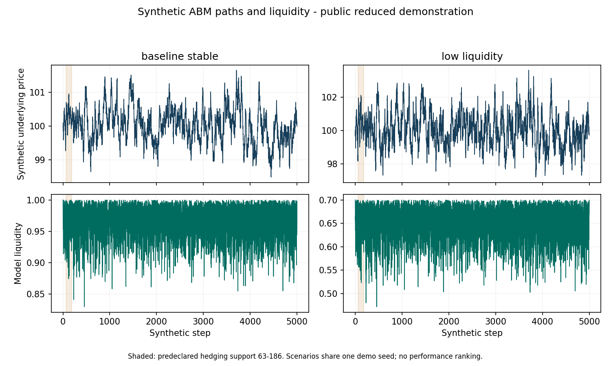

# ABM liquidity and causal delta hedging

A small CPU demonstration of agent-based market dynamics and discrete option
hedging, extracted from Subba Cecchetto's MSc thesis research. Five numerical
source modules are preserved byte for byte. The new runner makes a deliberately
limited example independently inspectable; it does not reproduce the full thesis.

The example connects heterogeneous agent demand, persistent stress and endogenous
liquidity to a causal Black-Scholes delta hedge with explicit transaction costs.
It uses **synthetic observations generated locally**. No account, market-data
subscription, paid API, cloud compute or proprietary software is needed.

## What runs

- Two declared thesis scenario configurations: `baseline_stable` and
  `low_liquidity`, both using the new illustration seed `20261105`.
- One path of 5,001 observations per scenario. The original adapter's path-length
  check is retained, together with the original numerical guards.
- Four predeclared, overlapping option windows starting at steps 63, 83, 103 and
  123, each lasting 63 steps. Only the first 187 observations enter these windows.
  The `validation` field is an existing schema label, **not an untouched research
  holdout** in this demonstration.
- Inception volatility estimated from the 63 already observed returns. The same
  fixed estimate prices the option and determines its subsequent delta hedge.
- Cash accrual at 2% annualized with 252 steps per year; a cost of 0.001 times
  traded notional, including the initial hedge. The original convention marks the
  terminal stock position to market without a terminal liquidation trade or fee.
- Hedging error, loss, turnover, transaction costs, VaR95 and ES95. These are
  descriptive diagnostics on four overlapping windows per scenario, not reliable
  estimates of tail risk or independent statistical observations.

## Setup and exact commands

The pinned dependencies support Python 3.9-3.12. Only the environments actually
executed in [VALIDATION.md](VALIDATION.md) are claimed as tested. Python 3.13 and
later are outside this pinned setup. The original research interpreter is Python
3.9.1; a fresh portable environment can use a different supported Python version,
which must be recorded rather than treated as the original research environment.

From the repository directory, create an isolated environment:

```text
python -m venv .venv
```

Activate it on Windows PowerShell with `.\.venv\Scripts\Activate.ps1`, or on
Linux/macOS with `source .venv/bin/activate`. Then run:

```text
python -m pip install -r requirements.txt
python -B -m unittest discover -s tests -v
python -B run_demo.py --output-dir outputs
python -B compare_outputs.py --actual outputs/summary.json
```

Activation is optional: use `.venv\Scripts\python.exe` on Windows or
`.venv/bin/python` on Linux/macOS instead of `python` in the commands above.
The test suite uses `unittest`; pytest is not required. The demonstration performs
no downloads or network calls after dependencies have been installed.

## Inspect the outputs

| File | What to inspect |
| --- | --- |
| `outputs/summary.json` and `summary.csv` | Scenario identities, accounting conventions and descriptive metrics |
| `outputs/window_results.csv` | Eight individual option-window outcomes, including unfavourable values |
| `outputs/accounting_trace.csv` | All 504 hedge decisions with delta, trade, fee and cash before/after accrual |
| `outputs/path_diagnostics_subsampled.csv` | Small synthetic example dataset, every twentieth observation of each path |
| `outputs/synthetic_paths.png` | Underlying prices and endogenous liquidity, with the hedging support shaded |
| `outputs/run_receipt.json` | Actual versions, resource measurements and output checksums |

The generated chart is a simulation diagnostic, not an investment performance
chart. The subsampled CSV is for inspection; all observations are simulated before
selecting the predeclared hedging prefix.

The recorded reference metrics are in
[examples/expected_summary.json](examples/expected_summary.json). Comparison uses
absolute and relative tolerance `1e-9`; it does not promise byte equality across
platforms. The unmodified numerical modules retain their own `1e-12` internal
identity checks. A tolerance failure must be investigated and recorded; do not
replace the reference simply to make a comparison pass.



## Source structure and methodology

`src/abm_simulator.py` contains the original market mechanism. Fundamentalist,
chartist and noise-trader demands affect prices through liquidity-sensitive
impact. Persistent stress amplifies demand-related liquidity deterioration.
This is a stylized agent-based model, not a calibrated exchange order book.

`src/causal_hedging_data.py` constructs immutable option windows from information
available at each decision. `src/causal_black_scholes_baseline.py` supplies the
discrete benchmark and its self-financing account trace. `src/black_scholes.py`
and `src/risk_metrics.py` provide the analytic option functions and risk metrics.

`run_demo.py` is the new publication wrapper; it verifies the preserved source
hashes before running. Tests cover a hand-solvable liquidity floor, deterministic
seeds, future-data mutation, independent Decimal cash reconciliation, initial
fees, invalid input and the retained 5,001-row guard.

## Relationship to the original research

The original thesis is *Quantum-Inspired Agent-Based Market Simulator for Robust
Deep Hedging under Endogenous Liquidity Regimes*. Its larger research record
includes neural hedges, quantum-inspired regime features, out-of-distribution
experiments and historical SPY transfer. Those studies are **not rerun or
reproduced here**. This example contains no fitted weights, optimizer, training,
quantum-regime feature comparison or real market dataset.

The recorded research did not establish robust aggregate neural superiority over
Black-Scholes. That negative finding remains part of the research record; this
small analytic benchmark neither strengthens nor overturns it. It also does not
establish executable trading, investment profitability or production readiness.

For professional context, see [the portfolio](https://subbace.github.io/).
Source checksums, origin and rights review are documented in
[SOURCE_MANIFEST.json](SOURCE_MANIFEST.json) and
[RIGHTS_AND_PROVENANCE.md](RIGHTS_AND_PROVENANCE.md).


## Clean independent environment validation

A fresh local Git clone was verified byte-for-byte and the README commands were executed in a new isolated **CPython 3.12.14 / Windows / CPU** environment. Installation, checks and examples all exited **0**. The exact commands, versions, installed distributions and wall times are in [validation/CLEAN_ENVIRONMENT.json](validation/CLEAN_ENVIRONMENT.json). Other operating systems are not tested. Timing is engineering evidence, not an economic or algorithmic speed claim.

Recorded passing counts: unit_tests_passed = 8. These counts describe tests, not project completion or investment effectiveness.


## Clone this public demonstration

```text
git clone https://github.com/subbace/abm-liquidity-hedging-demo.git
cd abm-liquidity-hedging-demo
```

Then follow the setup and run commands above. See the [professional portfolio](https://subbace.github.io/#work) for the other documented workstreams. Public source is provided for independent inspection and running the accompanying example; no general open-source reuse licence is asserted.
